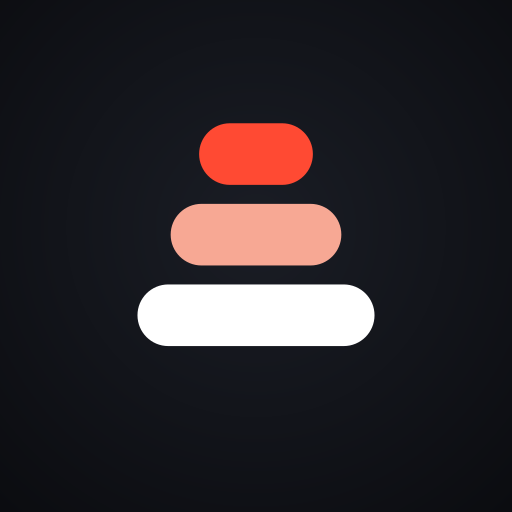
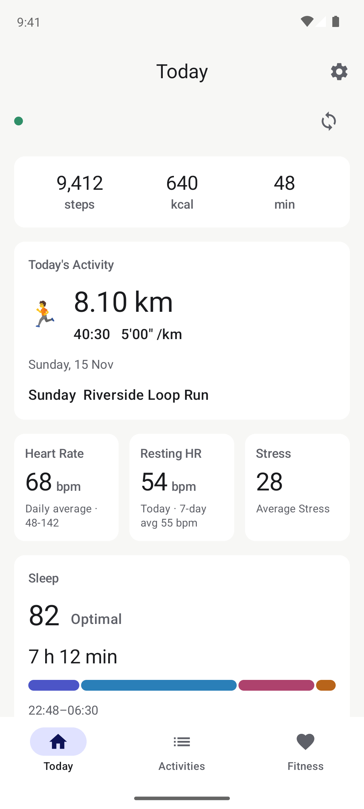
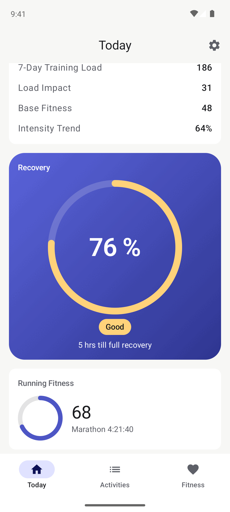
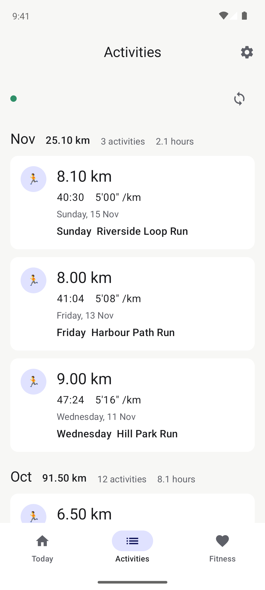
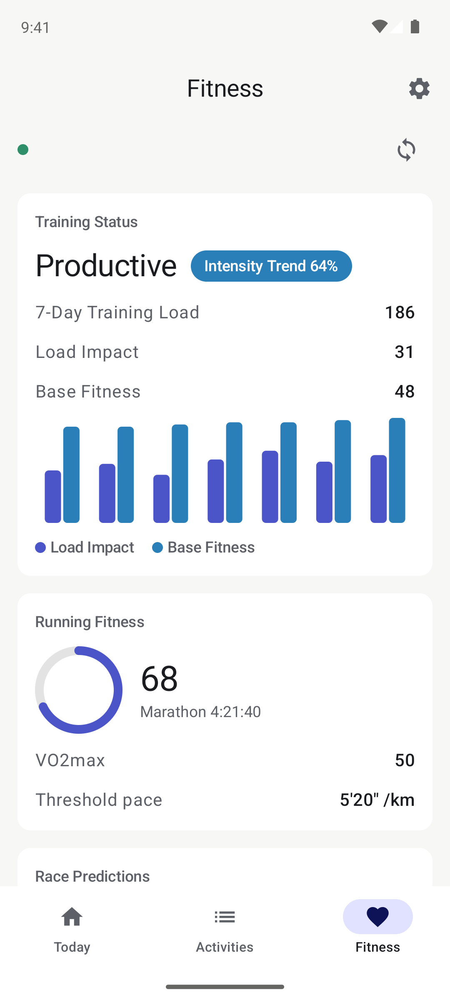
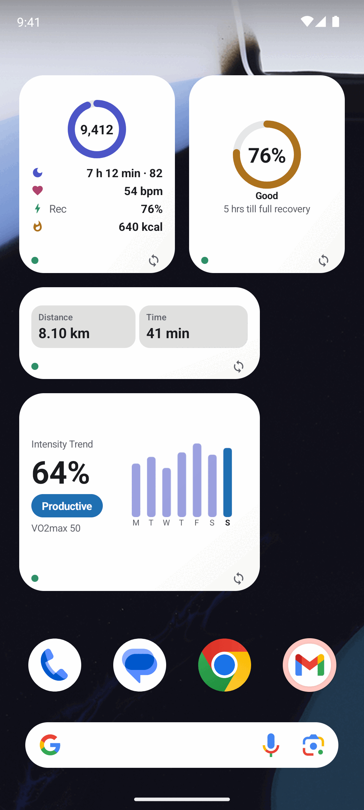
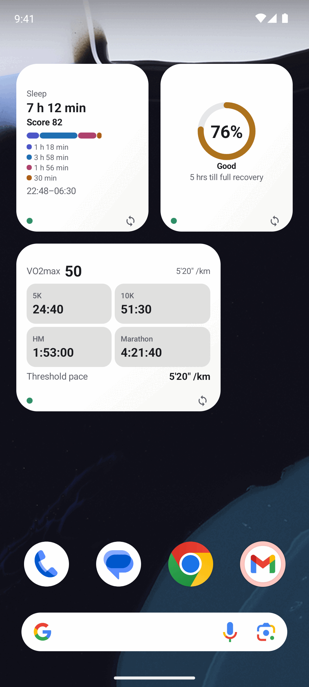
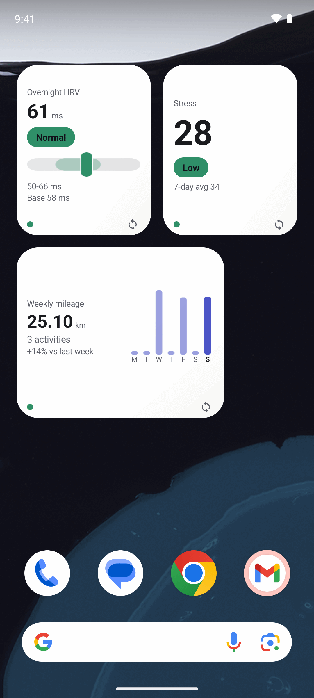
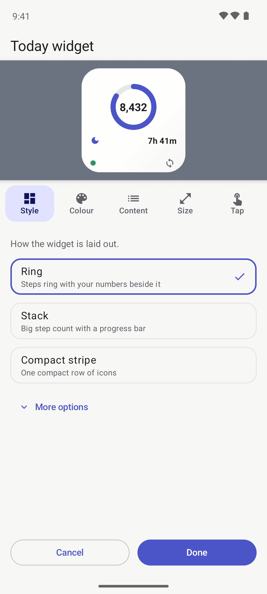
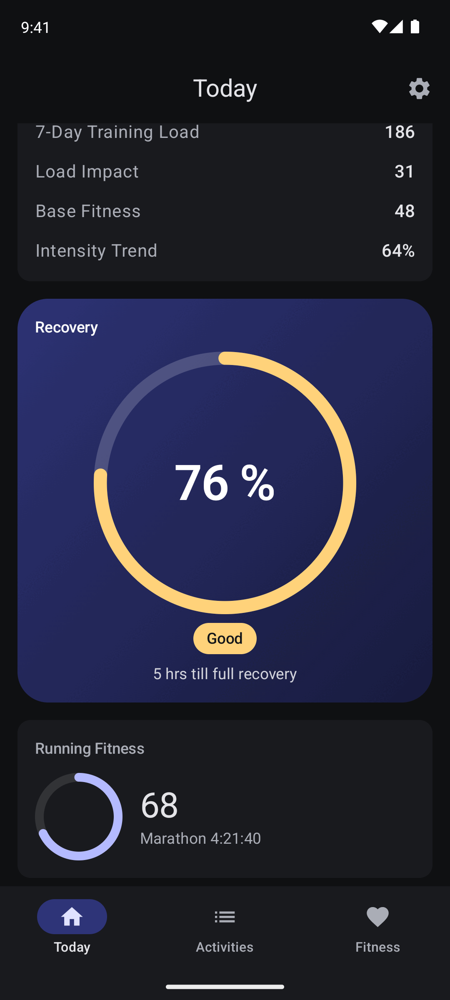

<p align="center">
  
</p>

<h1 align="center">Cairn</h1>

<p align="center">
  Your COROS recovery, sleep and training at a glance, in home-screen widgets.<br>
  Private and on your phone. No Cairn server, no ads, no analytics.
</p>

<p align="center">
  <a href="https://appdrop-store.vercel.app/apps/cairn"><b>Get it on AppDrop</b></a> ·
  <a href="https://appdrop-store.vercel.app/d/cairn">Direct APK download</a> ·
  <a href="https://github.com/manojanasuri16/cairn/releases/latest">Latest release</a>
</p>

<p align="center">
  
  
  
  
</p>

<p align="center">
  
  
  
  
  
</p>

## What it is

Cairn shows the numbers your COROS watch has already sent to COROS: steps, sleep, recovery, training load and fitness. It shows them in small, quiet widgets and a simple app, and each number carries an honest note about how old it is.

Cairn reads from COROS's official MCP server (and optionally Health Connect), caches everything on the phone, and draws its widgets from that cache.

## Features

**Widgets**

- **Today**: steps, sleep, recovery, heart rate and calories, sized from a single ring up to a full card.
- **Recovery**: recovery percentage, its level word and time to full recovery.
- **Last activity**: distance, time, pace and heart rate for your latest run.
- **Training load** (Intensity Trend): the load ratio as a percent, a week of bars and your VO2max.
- **Sleep**: duration, score, stage bar and bedtime window.
- **Fitness**: a race grid with VO2max, threshold pace and predicted 5K, 10K, half and marathon times.
- **Overview**: a grid of 1 to 6 stats you choose and order (steps, sleep, recovery, resting HR, heart rate, HRV, stress, weekly mileage and more).
- **Overnight HRV**: last night's average (`65 ms`), COROS's own word for it (Elevated, Normal, Low) as a coloured pill, and "Normal range 46-58 ms". Range bar, 7 nights or number and pill.
- **Heart rate**: Resting HR as the main number (`51 bpm`) with its 7-day average, plus today's average and min-max. Resting and 7-day line, min / average / max bar, or a pair.
- **Stress**: today's average (`30`) with a level word (Relaxed, Low, Medium, High) as a pill. Number and level, 7-day bars coloured by level, or a gauge arc.
- **Weekly mileage**: distance this week, Monday to Sunday (`25.10 km`), the activity count and the change against last week. Bars per day, a goal ring (set a weekly goal in the editor; without one it shows bars) or number and trend. Km or miles, per widget.

**Style and customise**

- 11 looks: **Clean** (default), Dusk, Dawn, Forest, Midnight, Sunrise, Minimal, Ocean, Violet, Berry, and Transparent (with opacity).
- Each widget has its own editor: Style, Colour, Content, Size and Tap, with a live preview. Weekly mileage also has a weekly goal.
- Sizes: Small 2x2, Wide 4x2, Large 4x3. Bigger cells show more.

**Freshness, on every widget**

- A coloured dot shows how fresh the data is: green, amber or red. The state is also written in words, not colour alone.
- A short age appears only when data is old (for example "2h" or "3d").
- A sync button sits beside the dot. It syncs in the background without opening any app.
- Tapping a widget opens COROS (or the target you choose) and starts a sync, so the data catches up right after.

**The app**

- Screens: Today, Activities, Fitness, Settings and Diagnostics.
- Named and ordered like the COROS app (see below).
- Manual sync any time, or automatic refresh every 5, 15, 30 or 60 minutes (default 30).
- Health Connect as a read-only fallback source.
- App icon shortcuts for adding a widget and opening COROS.
- Units in km or miles, light, dark or system mode, optional Material You, TalkBack labels and large-font support.

## Reads like COROS

Cairn uses the names and number formats you already know from the COROS app.

| COROS card | Cairn shows |
|---|---|
| Training Status: Intensity Trend | `47%` (the load ratio as a percent) |
| Load Impact, Base Fitness | Short-term and long-term load, under the same names |
| Recovery | `76 %`, "Good", "5 hrs till full recovery" |
| Running Fitness | `68`, "Marathon 4:21:40" |
| Today's Activity | `8.10 km`, `40:30`, `5'00" /km` |
| Resting HR | `54 bpm`, "Today · 7-day avg 55 bpm" |
| Overnight HRV | `65 ms`, the server's word ("Elevated"), "Normal range 46-58 ms" |
| Stress | `30`, level word from Cairn's assumed bands (Relaxed 1-25, Low 26-50, Medium 51-75, High 76-99) |
| Activities, month header | `25.10 km`, "3 activities" (Cairn sums the same way for the week, Monday to Sunday) |

## How fresh is the data?

Cairn cannot make your watch sync. Data is only as fresh as the COROS app's last sync from your watch to COROS's cloud. Cairn shows that age honestly on every widget.

To keep things fresh:

- Open the COROS app now and then so it syncs your watch.
- In Android's battery settings, set COROS to **unrestricted** (or "don't optimise"), so it can keep syncing in the background.
- Tap a widget to open COROS. Cairn refreshes right after you return.

## Troubleshooting

- **Sign-in stuck:** tap the button on the COROS page, or open the COROS account screen from Settings and try the local method or the device code.
- **A widget shows "Loading" or looks old:** tap its sync button, or remove and re-add it. Cairn refreshes all widgets after an update.
- **Numbers look old:** see "How fresh is the data?" above.

## Install

1. Get the APK from [AppDrop](https://appdrop-store.vercel.app/apps/cairn) or from the [latest release on GitHub](https://github.com/manojanasuri16/cairn/releases/latest).
2. Open the file on your phone. You may need to allow *Install unknown apps* for your browser or file manager.
3. Requires **Android 14 or newer** (minSdk 34).

The release APK is signed with the Cairn release key, so each new version installs over the last one and keeps your data. Don't uninstall to update.

## Privacy

- **On your phone.** Data is cached on the device and the widgets read that cache. There is no Cairn server, no analytics, no ads and no crash-reporting service.
- **Sign-in and the bounce page.** COROS only accepts `https` or loopback redirect URIs, so Cairn registers `https://manojanasuri16.github.io/cairn/callback/`. After you approve, that static page (hosted on GitHub Pages, source in `docs/callback/`) immediately hands the result to Cairn through an `app.cairn.oauth://` link. It only forwards the one-time code, stores nothing and runs no analytics; the code is protected by PKCE and is useless without a secret that never leaves your phone.
- **Troubleshooting sign-in.** If Cairn doesn't open after you approve, tap the button on the COROS page, or use "Open the sign-in page again". Under "Having trouble signing in?" you can try the local method (a short notification "Signing in to COROS" appears) or the device code. Sign-in diagnostics (method, stage, last failure) are on the COROS account and Sync diagnostics screens and contain no secrets. Sign-in sessions expire after a few minutes.
- **Official sign-in.** You sign in on COROS's own OAuth page for its MCP server. Cairn never sees or stores your password. Tokens are encrypted with the Android Keystore, excluded from backups, and sent only to COROS.
- **Health Connect is read-only.** It is optional and used only as a fallback source.
- **AppDrop.** Cairn contacts the AppDrop store only to check for updates and to send feedback if you choose to. No health data is ever sent.
- **Backups off.** Android cloud backup and device transfer exclude the app's data. "Delete data" in Settings clears the cache.

## Honest limits

- **Freshness depends on COROS.** See [How fresh is the data?](#how-fresh-is-the-data) above.
- **The COROS MCP replies are not a documented stable API.** COROS can change them. Cairn parses them defensively and shows less rather than wrong values, but a COROS update can still break something until Cairn is updated.
- **Some values may differ slightly from the COROS app.** For example, one sleep reading was observed to differ from COROS's own figure. COROS does not publish its sleep-score bands, so the rating words are Cairn's own.
- **No true zone data.** COROS's time-in-zone data is not available through the tools Cairn uses, so Cairn does not show a real 80/20 split.
- **Background work can be delayed.** Battery saver and standby buckets can slow refreshes. The footer always shows the real age.

## Build from source

Requirements: JDK 21 and the Android SDK (platform 36).

```bash
# 1. Point Gradle at your SDK (local.properties is gitignored)
echo "sdk.dir=/path/to/Android/sdk" > local.properties

# 2. Build and test
./gradlew assembleDebug
./gradlew testDebugUnitTest
./gradlew assembleRelease   # signed with the release key if configured, else the debug key (with a warning)
```

- **Release signing** uses `CAIRN_STORE_FILE`, `CAIRN_STORE_PASSWORD`, `CAIRN_KEY_ALIAS` and `CAIRN_KEY_PASSWORD` in `~/.gradle/gradle.properties`. The keystore stays outside the repo. No secrets live in the repository.
- **Debug builds** include a Tools screen with a read-only MCP tool explorer and a Demo mode that fills the app with fictional data for screenshots. Release builds contain neither.

## Project layout

```
app/                  Application, navigation, screens, AppDrop updater
core/model/           Pure Kotlin domain types and freshness
core/database/        Room cache (entities, DAOs)
core/datastore/       Settings, sync state, Keystore-encrypted tokens
core/designsystem/    Palette and Material 3 theme
core/common/          Time, units and formatting helpers
data/                 Repositories and source merge rules
source/healthconnect/ Health Connect reader (read-only)
source/corosmcp/      COROS OAuth and MCP client, defensive parsers
sync/                 WorkManager sync, schedules, freshness states
widget/               Glance widgets, layouts, editor and previews
```

## Tech

Kotlin · Jetpack Compose (Material 3) · Glance (app widgets) · Room · WorkManager · Health Connect · OAuth 2.0 with PKCE (hand-rolled client) · kotlinx.serialization.

## Project docs

- [docs/plan.md](docs/plan.md): research, architecture, widget design and milestones.
- [docs/data-sources.md](docs/data-sources.md): which COROS tool feeds which card, and the known assumptions.
- [docs/testing.md](docs/testing.md): device, battery and accessibility test steps.
- [CHANGELOG.md](CHANGELOG.md): what changed in each version.

## Disclaimer

Cairn is an independent project. It is not affiliated with, endorsed by or sponsored by COROS Wearables Inc. COROS is a trademark of its owner.

## Licence

Cairn is open source under the [MIT licence](LICENSE).
